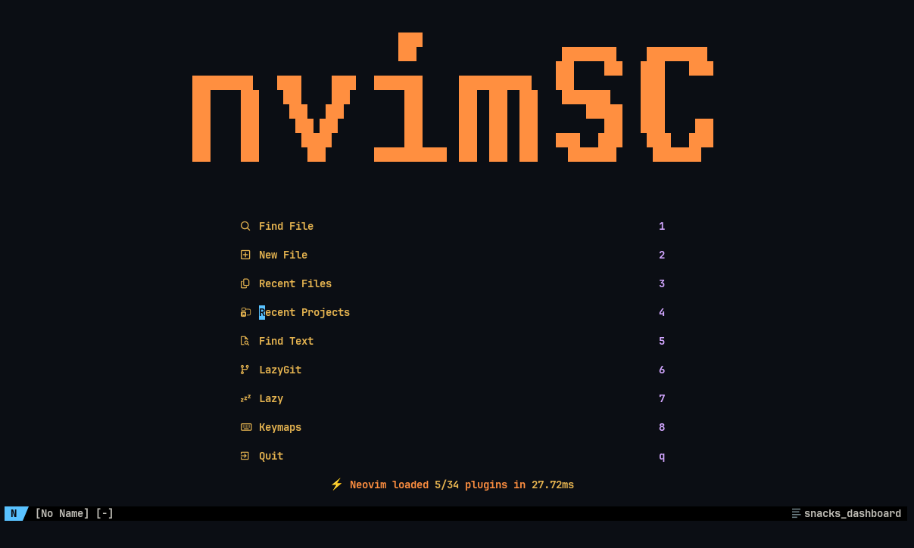

+++
title = "Overview"
+++

A simple and minimal Neovim configuration designed for developers who want a lightweight yet powerful editing experience out of the box.

## Features

- **Lightweight and fast** — minimal overhead for smooth performance
- **Pre-configured plugins** — essential plugins installed automatically by `lazy.nvim`
- **Ayu Dark theme** — `neovim-ayu` colorscheme with a matching Lualine statusline
- **LSP support** — built-in Language Server Protocol integration for completion, rename, and formatting
- **Diagnostics** — real-time error, warning, and info notifications with easy navigation
- **Optimized key mappings** — carefully chosen shortcuts with `Space` as the leader key
- **Git integration** — visual git signs and Lazygit support for version control
- **File explorer** — Neo-tree file navigation for quick project browsing
- **Auto-completion** — `nvim-cmp` with LSP, buffer, path, and snippet sources

## Start here

- [Installation](@/docs/install.md)
- [Keymaps](@/docs/keymaps.md)
- [Plugins](@/docs/plugins.md)
